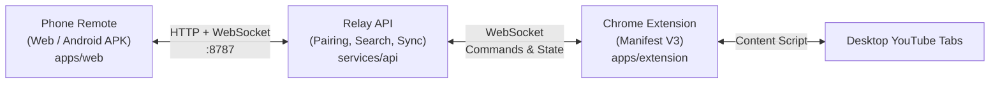

<div align="center">
  

  <h1>RELO — YouTube Bridge</h1>
  <p><strong>Turn your phone into a real-time remote control for desktop YouTube.</strong></p>

  <p>
    
    
    
    
    
    
    
    
  </p>
</div>

---

## The Story — Why RELO?

YouTube is built for a keyboard and mouse on desktop, and for a touchscreen on mobile—but **when you're watching YouTube on your laptop, desktop monitor, or TV-connected browser from across the room**, neither works well:

- You're settled in on the couch or bed, and an ad, loud volume spike, or long intro hits—and your mouse is across the room.
- You have three YouTube tabs open (a podcast, a music mix, and a tutorial) and want to switch tabs, scrub back 15 seconds, toggle captions, or search for the next video **without getting up**.
- Existing remote apps either require installing heavy desktop agents, forcing you onto the same OS ecosystem, or mirroring your entire screen just to click Pause.

**RELO solves this super-niche problem cleanly** by turning your phone into a dedicated, zero-clutter YouTube remote for your desktop Chrome browser:

1. **Open the Chrome Extension** on your desktop to generate a **6-digit pairing PIN**.
2. **Open RELO on your phone** (mobile web app or native Android APK) and enter the PIN.
3. **Confirm pairing once**—and your phone instantly becomes a live hardware-style YouTube controller for playback, search, volume, captions, and tab switching.

### Pictorial Storyline


### Where RELO Shines
- **Couch / Bed Viewing**: Pause, scrub, mute, or toggle fullscreen on your monitor or TV-connected PC without touching a mouse.
- **Multi-Tab Control**: See every open YouTube tab on your desktop, switch which tab you're controlling, bring a tab into focus, or close finished tabs from your phone.
- **Hands-Free Queueing**: Search YouTube with live autocomplete right from your phone and launch the next video directly into your desktop browser.

---

## Architecture



| Package | Path | Role |
| :--- | :--- | :--- |
| **Relay API** | `services/api` | Node.js HTTP + WebSocket server (`:8787`) managing 6-digit PIN pairing, authorization, YouTube Data API search/autocomplete, and live state sync. |
| **Phone & Android App** | `apps/web` | React 19 + Vite + TypeScript mobile remote (`:5173`) wrapped with Capacitor (`apps/web/android`) to produce `RELO-debug.apk`. |
| **Chrome Extension** | `apps/extension` | Manifest V3 extension that connects to the relay, tracks open YouTube tabs, and executes playback and tab commands. |

---

## Features

- **6-Digit PIN Pairing & Authorization**: Explicit desktop confirmation with favorite-device support so trusted phones reconnect cleanly.
- **Full Playback Control**: Play/pause, interactive seek bar, skip forward/backward, volume & mute, playback speed, captions, and fullscreen toggle.
- **YouTube Search & Autocomplete**: Search YouTube directly from your phone and launch videos onto your active or selected desktop tab.
- **Multi-Tab Management**: Inspect all open YouTube tabs on your desktop, switch the active control target, focus a tab, or close tabs remotely.
- **Android APK Ready**: Custom centered adaptive launcher icon, sticky top status header, and `RELO-debug.apk` Gradle build output.

---

## Design System & Brand Assets

RELO uses a dark-first, high-contrast media interface inspired by theater and remote-control ergonomics.

### Logo Lockup & Marks

| Mark | Preview | Usage |
| :--- | :---: | :--- |
| **Full Wordmark** |  | Primary header lockup (`relo-wordmark-dark.png` / `relo-wordmark-transparent.png`). |
| **Compact Symbol** |  | Android adaptive launcher icon and compact placements (`relo-symbol-dark.png`). |
| **Extension Icon** |  | Browser toolbar and favicon slots (`16`, `32`, `48`, `128` px). |

See [`RELO_LOGO_GUIDELINES.md`](RELO_Design_System/RELO_Logo_Assets/RELO_LOGO_GUIDELINES.md) for full asset usage rules.

### Color Palette & Tokens (`apps/web/src/theme.css`)

| Token | Hex | Usage |
| :--- | :--- | :--- |
| `--background` | `#080808` | App canvas and sticky header backdrop |
| `--card` / `--popover` | `#181818` | Elevated control surfaces and device cards |
| `--primary` | `#ff0033` | Primary brand red, active states, and live indicators |
| `--secondary` | `#262626` | Secondary buttons and pill controls |
| `--muted` | `#242424` | Subtle containers and inactive tracks |
| `--muted-foreground` | `#b8b8bd` | Secondary labels and timestamps |
| `--border` | `#414141` | Hairline dividers and card outlines |
| `--ring` | `#9cc4ff` | Keyboard and accessibility focus ring |

- **Typography**: `Roboto` variable font (`apps/web/src/fonts/Roboto-Variable.ttf`, weights `100–900`).
- **Border Radii**: `6px` (`sm`), `8px` (`md`), `12px` (`lg`), `16px` (`xl`).

---

## Prerequisites

- **Node.js `22+`** and `npm`
- **Google Chrome** (for loading the unpacked extension)
- **YouTube Data API v3 Key** (optional, for YouTube search in `services/api`)
- **Android Studio / JDK 21 + Android SDK** (only needed for building the Android APK)

---

## Setup & Running Locally

### 1. Relay Server (`services/api`)

```bash
cd services/api
cp .env.example .env
# Add your YOUTUBE_API_KEY in .env
npm install
npm start
```

- Runs on `http://localhost:8787` (HTTP + WebSocket).
- Runtime pairing state is saved locally in `services/api/data/relay-state.json` (excluded from Git).

### 2. Chrome Extension (`apps/extension`)

```bash
cd apps/extension
npm install
npm run build
```

1. Open `chrome://extensions` in Chrome and enable **Developer mode**.
2. Click **Load unpacked** and choose `apps/extension/dist`.
3. Open the RELO extension popup to connect to the relay and generate your pairing PIN.

### 3. Phone Web App (`apps/web`)

```bash
cd apps/web
npm install
npm run dev
```

- Runs on `http://0.0.0.0:5173` so any phone on the same Wi-Fi network can access it.

### 4. Android APK (`apps/web/android`)

```bash
cd apps/web
npm run android:sync
cd android
./gradlew assembleDebug
```

- Outputs `apps/web/android/app/build/outputs/apk/debug/RELO-debug.apk`.
- Or run `npm run android:open` from `apps/web` to open the project in Android Studio.

---

## Testing & Verification

```bash
# Relay API
cd services/api && npm run typecheck && npm test

# Chrome Extension
cd apps/extension && npm run typecheck && npm test

# Phone Web App
cd apps/web && npm run typecheck && npm run build
```

---

## How It Was Built & What I Learned

Building RELO meant coordinating three separate runtimes—a **Node.js relay**, a **Chrome Manifest V3 extension**, and a **React + Capacitor Android app**—so every command feels instantaneous:

- **Real-Time State Sync**: Designed a lightweight WebSocket protocol in `services/api` with 6-digit PIN pairing, explicit desktop authorization, and persistent pairing tokens so trusted devices reconnect cleanly.
- **Chrome MV3 Extension Architecture**: Wired background service workers to YouTube content scripts (`apps/extension`) to track active tabs, read live playback state, and execute play/pause, seek, volume, speed, caption, and tab-switching commands.
- **Mobile & Android Polish**: Built a dark-first mobile UI (`apps/web`) with a sticky status header and packaged it with Capacitor (`apps/web/android`), including custom Android adaptive launcher icons sized to the 66dp safe zone so the RELO mark never crops.

## Future Improvements

- [ ] Signed release APK / AAB published via **GitHub Releases**
- [ ] Optional remote/cloud relay mode for controlling desktops outside the local Wi-Fi network
- [ ] Shared playback queue & Watch Later sync across paired devices
- [ ] Keyboard shortcuts and customizable quick-seek intervals

## Live Demo

> *Demo video / GIF coming soon — record a quick clip of pairing your phone and controlling desktop YouTube, then drop it here.*

---

## Repository Hygiene

- Secrets (`services/api/.env`), runtime pairing state (`services/api/data/`), signing keys (`*.keystore`, `*.jks`), `node_modules/`, `dist/`, and compiled `*.apk` artifacts are excluded via `.gitignore`.
- Use [`services/api/.env.example`](services/api/.env.example) as a template when setting up a new environment.
