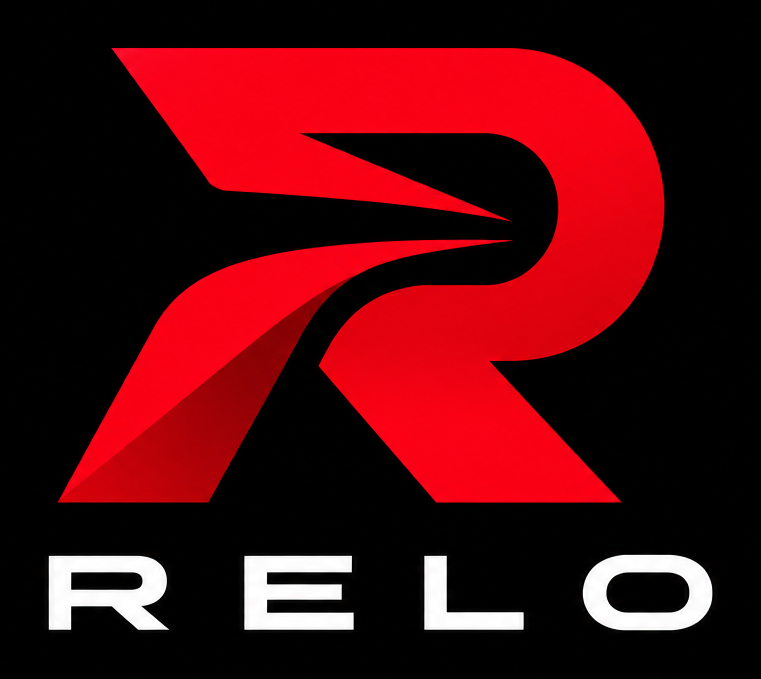
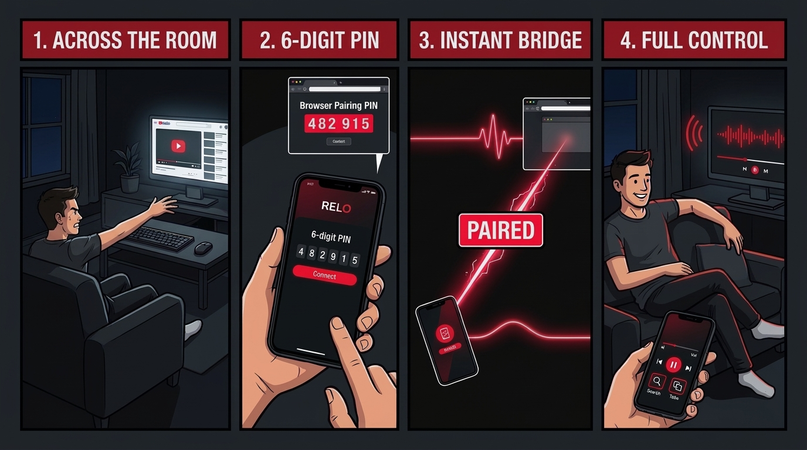
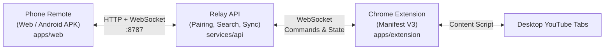
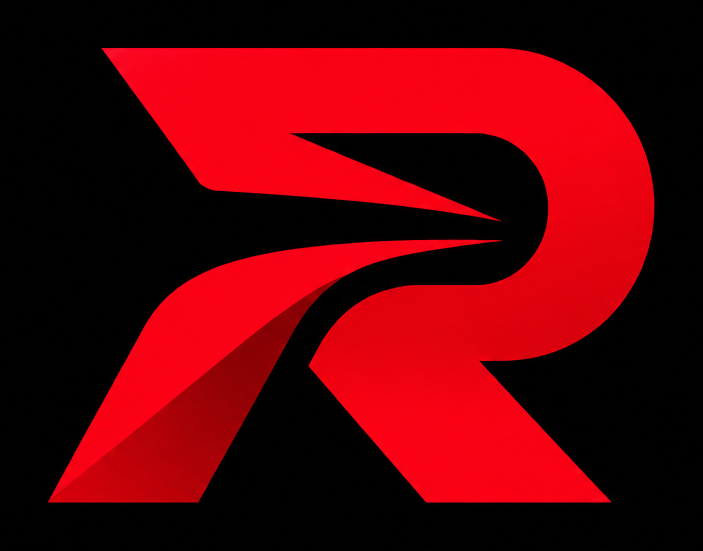

<div align="center">
  

  <h1>RELO: YouTube Bridge</h1>
  <p><strong>Turn your phone into a real-time remote control for desktop YouTube.</strong></p>

  <p>
    
    
    
    
    
    
    
    
  </p>
</div>

---

## The Story: Why RELO?

Smart TVs have their own YouTube app, so you can easily cast and control them from your phone. **Laptops and desktops don't**—YouTube runs in a regular web browser, so once you sit back on the couch or bed, you have to get up every time you want to pause, scrub, change volume, or play the next video.

**RELO** gives your desktop browser the same effortless phone remote experience:

1. **Open the Chrome Extension** on your computer to get a **6-digit PIN**.
2. **Enter the PIN** on your phone (web app or Android APK).
3. **Approve once** and control playback, volume, search, and YouTube tabs right from your hand.

### Pictorial Storyline



### Where RELO Shines
- **Couch or Bed Viewing**: Pause, scrub, mute, or toggle fullscreen on your laptop or monitor without touching the mouse.
- **Multi-Tab Control**: See every open YouTube tab on your desktop, switch which tab you're controlling, bring a tab into focus, or close finished tabs from your phone.
- **Hands-Free Queueing**: Search YouTube with live autocomplete right from your phone and launch the next video directly into your desktop browser.

---

## Architecture



| Package | Path | Role |
| :--- | :--- | :--- |
| **Relay API** | `services/api` | Node.js HTTP + WebSocket server (`:8787`) managing 6-digit PIN pairing, authorization, YouTube Data API search/autocomplete, and live state sync. |
| **Phone & Android App** | `apps/web` | React 19 + Vite + TypeScript mobile remote (`:5173`) wrapped with Capacitor (`apps/web/android`) to produce `RELO-debug.apk`. |
| **Chrome Extension** | `apps/extension` | Manifest V3 extension that connects to the relay, tracks open YouTube tabs, and executes playback and tab commands. |

---

## Technologies Used

- **Mobile & Web UI (`apps/web`)**: React 19, TypeScript 5.7, Tailwind CSS v4, Radix UI, Lucide Icons, Vite 6
- **Android App (`apps/web/android`)**: Capacitor 8, Android SDK, Gradle
- **Browser Receiver (`apps/extension`)**: Chrome Extensions Manifest V3, React 19, TypeScript, Vite
- **Relay Backend (`services/api`)**: Node.js 22+, `ws` (WebSockets), YouTube Data API v3, Node built-in test runner (`node --test`)

---

## Features

- **6-Digit PIN Pairing & Authorization**: Explicit desktop confirmation with favorite-device support so trusted phones reconnect cleanly.
- **Full Playback Control**: Play/pause, interactive seek bar, skip forward/backward, volume & mute, playback speed, captions, and fullscreen toggle.
- **YouTube Search & Autocomplete**: Search YouTube directly from your phone and launch videos onto your active or selected desktop tab.
- **Multi-Tab Management**: Inspect all open YouTube tabs on your desktop, switch the active control target, focus a tab, or close tabs remotely.
- **Android APK Ready**: Custom centered adaptive launcher icon, sticky top status header, and `RELO-debug.apk` Gradle build output.

---

## Design System & Brand Assets

RELO uses a dark-first, high-contrast media interface inspired by theater and remote-control ergonomics.

### Logo Lockup & Marks

| Mark | Preview | Usage |
| :--- | :---: | :--- |
| **Full Wordmark** |  | Primary header lockup (`relo-wordmark-dark.png` / `relo-wordmark-transparent.png`). |
| **Compact Symbol** |  | Android adaptive launcher icon and compact placements (`relo-symbol-dark.png`). |
| **Extension Icon** |  | Browser toolbar and favicon slots (`16`, `32`, `48`, `128` px). |

See [`RELO_LOGO_GUIDELINES.md`](RELO_Design_System/RELO_Logo_Assets/RELO_LOGO_GUIDELINES.md) for full asset usage rules.

### Color Palette & Tokens (`apps/web/src/theme.css`)

| Token | Hex | Usage |
| :--- | :--- | :--- |
| `--background` | `#080808` | App canvas and sticky header backdrop |
| `--card` / `--popover` | `#181818` | Elevated control surfaces and device cards |
| `--primary` | `#ff0033` | Primary brand red, active states, and live indicators |
| `--secondary` | `#262626` | Secondary buttons and pill controls |
| `--muted` | `#242424` | Subtle containers and inactive tracks |
| `--muted-foreground` | `#b8b8bd` | Secondary labels and timestamps |
| `--border` | `#414141` | Hairline dividers and card outlines |
| `--ring` | `#9cc4ff` | Keyboard and accessibility focus ring |

- **Typography**: `Roboto` variable font (`apps/web/src/fonts/Roboto-Variable.ttf`, weights `100–900`).
- **Border Radii**: `6px` (`sm`), `8px` (`md`), `12px` (`lg`), `16px` (`xl`).

---

## Prerequisites

- **Node.js `22+`** and `npm`
- **Google Chrome** (for loading the unpacked extension)
- **YouTube Data API v3 Key** (optional, for YouTube search in `services/api`)
- **Android Studio / JDK 21 + Android SDK** (only needed for building the Android APK)

---

## Setup & Running Locally

### 1. Relay Server (`services/api`)

```bash
cd services/api
cp .env.example .env
# Add your YOUTUBE_API_KEY in .env
npm install
npm start
```

- Runs on `http://localhost:8787` (HTTP + WebSocket).
- Runtime pairing state is saved locally in `services/api/data/relay-state.json` (excluded from Git).

### 2. Chrome Extension (`apps/extension`)

```bash
cd apps/extension
npm install
npm run build
```

1. Open `chrome://extensions` in Chrome and enable **Developer mode**.
2. Click **Load unpacked** and choose `apps/extension/dist`.
3. Open the RELO extension popup to connect to the relay and generate your pairing PIN.

### 3. Phone Web App (`apps/web`)

```bash
cd apps/web
npm install
npm run dev
```

- Runs on `http://0.0.0.0:5173` so any phone on the same Wi-Fi network can access it.

### 4. Android APK (`apps/web/android`)

```bash
cd apps/web
npm run android:sync
cd android
./gradlew assembleDebug
```

- Outputs `apps/web/android/app/build/outputs/apk/debug/RELO-debug.apk`.
- Or run `npm run android:open` from `apps/web` to open the project in Android Studio.

---

## Setup with AI

Anyone can clone and run RELO using an AI coding agent (Antigravity, Claude Code, Cursor, or Gemini CLI) by pasting this prompt:

```text
Clone https://github.com/LeonBijo/Relo.git, read llms.txt, install dependencies for services/api, apps/extension, and apps/web, build the Chrome extension, set up services/api/.env from .env.example, start the relay server and web app, and tell me how to load apps/extension/dist in Chrome.
```

---

## Testing & Verification

```bash
# Relay API
cd services/api && npm run typecheck && npm test

# Chrome Extension
cd apps/extension && npm run typecheck && npm test

# Phone Web App
cd apps/web && npm run typecheck && npm run build
```

---

## How It Was Built & What I Learned

Building RELO meant coordinating three separate runtimes (a **Node.js relay**, a **Chrome Manifest V3 extension**, and a **React + Capacitor Android app**) so every command feels instantaneous:

- **Real-Time State Sync**: Designed a lightweight WebSocket protocol in `services/api` with 6-digit PIN pairing, explicit desktop authorization, and persistent pairing tokens so trusted devices reconnect cleanly.
- **Chrome MV3 Extension Architecture**: Wired background service workers to YouTube content scripts (`apps/extension`) to track active tabs, read live playback state, and execute play/pause, seek, volume, speed, caption, and tab-switching commands.
- **Mobile & Android Polish**: Built a dark-first mobile UI (`apps/web`) with a sticky status header and packaged it with Capacitor (`apps/web/android`), including custom Android adaptive launcher icons sized to the 66dp safe zone so the RELO mark never crops.

## Future Roadmap

- [ ] **Multi-User Guest Mode**: Allow multiple friends or guests in the same room to connect via temporary guest PINs and queue videos with host approval
- [ ] **Signed Release Builds**: Publish signed `.apk` / `.aab` installers via **GitHub Releases**
- [ ] **Remote / Cloud Relay**: Optional hosted relay mode for controlling desktops outside the local Wi-Fi network
- [ ] **Shared Queue & Watch Later Sync**: Synchronized playback queue across paired devices

---

## Repository Hygiene

- Secrets (`services/api/.env`), runtime pairing state (`services/api/data/`), signing keys (`*.keystore`, `*.jks`), `node_modules/`, `dist/`, and compiled `*.apk` artifacts are excluded via `.gitignore`.
- Use [`services/api/.env.example`](services/api/.env.example) as a template when setting up a new environment.
